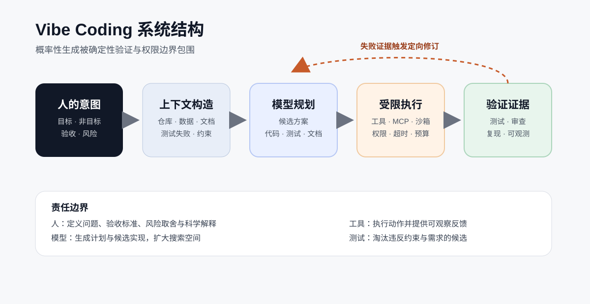

# Vibe Coding：面向 AI 研究者的定义、原理、应用与工程实践

Vibe Coding 是一种以自然语言表达目标、由生成式模型协助规划与编码，并通过运行结果反复修正软件的开发方式。它改变的主要是“意图到实现”的交互方式，而不是软件质量的基本判据。可运行的代码仍必须通过正确性、可复现性、安全性和可维护性验证。

本文面向具备机器学习、数据分析和基础软件工程背景的 AI 领域学生。内容将“氛围式生成”转换为可检查、可记录、可复现的研究与工程流程，便于用于课程项目、论文原型、实验工具和产品探索。

> 术语说明：Vibe Coding 是开发者社区形成的实践术语，目前没有统一的学术定义或独立基准。本文采用工程化定义：**人在目标与验收标准上负责，模型生成候选实现，工具执行，测试与证据决定是否接受结果。**

## 一句话理解

```text
Vibe Coding
= 意图规约
+ 上下文构造
+ 有边界的工具调用
+ 自动验证
+ 人的技术判断
```

它不是“把思考外包给模型”。更准确地说，它是把一部分实现成本转化为需求表达、上下文治理、结果审查和风险控制成本。



## 四个核心问题

| 问题 | 核心答案 | 继续阅读 |
|---|---|---|
| Vibe Coding 是什么？ | 以自然语言意图驱动、由模型与工具协同完成代码修改，并以反馈闭环验证结果的人机协作开发方式。 | [技术原理](principles.md) |
| 为什么能工作？ | 大模型提供代码的概率性生成与局部推理能力，Agent 循环提供多步执行能力，工具与测试把生成结果连接到可观察的现实。 | [技术原理](principles.md) |
| 在 AI 研究里怎么用？ | 适合实验工具、评估流水线、数据分析、交互演示和复现辅助；高风险训练、发布与科学结论仍须严格审查。 | [AI 应用场景](ai-scenarios.md) |
| 如何避免“看起来能用”？ | 用可执行验收、独立测试、可复现配置、最小权限、观测记录和人工判断组成质量门。 | [工程指南](engineering-guide.md) |

## 概念边界

| 概念 | 关注点 | 与 Vibe Coding 的关系 |
|---|---|---|
| AI 辅助编程 | 补全、解释、生成局部代码 | Vibe Coding 可以使用这些能力，但强调完整目标与反馈闭环 |
| Prompt Engineering | 如何组织模型输入 | 是上下文构造的一部分，不能替代测试与软件工程 |
| Agentic Coding | 模型通过工具进行多步操作 | 是 Vibe Coding 的高自主性实现形态，风险边界也更大 |
| 自然语言编程 | 用自然语言直接描述程序行为 | 更强调交互界面；Vibe Coding 还包含运行、验证和交付 |
| 软件自动化 | 用确定性脚本执行固定流程 | 可用于承载 Vibe Coding 中需要稳定、可审计的步骤 |

## 一个更可靠的循环


模型输出是候选，不是事实；测试结果是证据，但测试也可能遗漏需求；最终接受标准需要由任务风险决定。对于研究代码，还必须额外检查数据泄漏、随机种子、环境版本和评价协议。

## 适合与不适合

适合：

- 从明确接口出发构建实验脚本、数据清洗、指标计算和可视化；
- 快速探索可验证的算法原型；
- 生成测试、文档、迁移脚本和重复性工程代码；
- 将研究结果封装成可交互演示或内部工具；
- 在小步提交和自动检查下重构局部模块。

不适合直接放行：

- 未经人工审查的安全、医疗、金融或生产控制逻辑；
- 无法验证的数据删除、权限修改和密钥操作；
- 以一次运行代替统计评估的论文结论；
- 训练成本高、失败代价大且没有小规模试跑的实验；
- 含敏感数据、受版权约束代码或不可信指令的开放网络流程。

## 学习路线

1. 先读[技术原理](principles.md)，建立从模型生成到验证闭环的因果模型。
2. 再读[AI 应用场景](ai-scenarios.md)，选择与你的研究方向最接近的任务类型。
3. 按[工程指南](engineering-guide.md)定义任务契约、测试和权限边界。
4. 用[端到端案例](project-casebook.md)练习一次从需求到验收的完整迭代。
5. 通过[参考来源](references.md)延伸到原始论文和协议文档。

## 关键结论

Vibe Coding 的生产力来自缩短实现反馈循环，风险则来自把概率性输出误当成确定性事实。面向 AI 研究的正确目标不是“让模型多写代码”，而是建立一种可审计的人机协作系统：人的判断定义问题与证据标准，模型扩大实现搜索空间，工具和测试提供现实约束。
