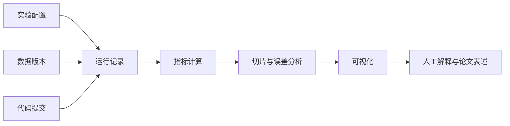
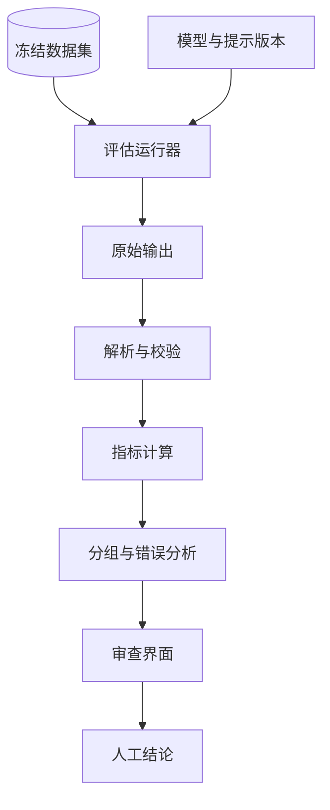
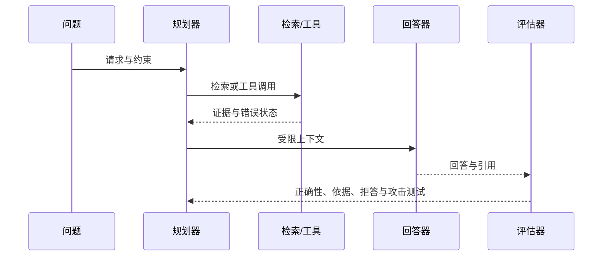

# Vibe Coding 在 AI 领域的应用场景

AI 研究既有探索性，也有高验证要求。Vibe Coding 更适合构建“可观察、可回滚、可独立验证”的研究基础设施，而不是替代实验设计或科学判断。

## 场景选择矩阵

| 场景 | 适配度 | 典型产出 | 必须保留的人工判断 |
|---|---:|---|---|
| 数据探索与可视化 | 高 | 清洗脚本、图表、交互式看板 | 指标定义、异常解释、数据偏差 |
| 评估与错误分析工具 | 高 | 测试集管理、指标计算、错误分类界面 | 评估协议、标签质量、置信区间 |
| 论文复现辅助 | 中高 | 环境脚本、配置映射、实验记录 | 原论文假设、公平比较、结论解释 |
| RAG/Agent 原型 | 中 | 检索、工具链、轨迹展示 | 检索语料边界、攻击测试、拒答策略 |
| 模型服务演示 | 中 | API、前端、日志、灰度开关 | 延迟预算、隐私、滥用风险 |
| 训练系统改造 | 中低 | 配置、数据加载、监控工具 | 数值稳定性、算力成本、实验隔离 |
| 自动科学结论生成 | 低 | 报告草稿、图表摘要 | 因果关系、统计效力、科学诚信 |
| 高风险自动决策 | 低 | 规则或模型决策流程 | 合规、公平性、申诉机制和安全评审 |

适配度高不等于可以直接进入生产。它表示任务更容易通过小样本、可执行测试和人工复核形成闭环。

## 1. 研究实验与消融工具

典型需求：

- 统一读取多个实验配置；
- 汇总准确率、F1、延迟、显存和成本；
- 按数据切片比较模型差异；
- 自动生成表格与图，但不自动宣称因果关系；
- 记录代码版本、数据版本、随机种子和硬件环境。

适合让模型完成的部分：

- 配置 Schema 与解析器；
- 指标实现和测试；
- 训练日志解析；
- 图表模板和导出脚本；
- 运行失败时的错误定位辅助。

不能省去的部分：

- 实验假设与主指标定义；
- 训练/验证/测试集隔离；
- 显著性检验或不确定性估计；
- 异常结果的人工解释；
- 论文中使用的结果复核。

## 2. 模型评估与错误分析平台

这是 AI 学生最容易获得高价值收益的场景，因为评估结果天然适合作为可执行证据。

一个最小评估工作台可以包含：

1. 固定版本的数据集与样本 ID；
2. 可替换的模型或提示模板；
3. 可测试的指标函数；
4. 原始输出、标准化输出和错误类型；
5. 按类别、长度、难度和来源的切片；
6. 置信区间、样本量和失败案例；
7. 可导出的实验报告。

工程验收可包括：

- 同一输入与配置重复运行能产生一致或可解释的结果；
- 空输出、解析失败和超长输入有明确状态；
- 指标在手工样例上结果正确；
- 错误分类可追溯到具体样本；
- 报告明确样本量、版本和置信区间。

## 3. RAG 与 Agent 原型

Vibe Coding 很适合快速搭建检索增强生成或工具型 Agent 的“实验室装置”，尤其是需要频繁修改切分策略、提示、工具 Schema 和可视化轨迹时。

建议先建立四个隔离边界：

| 边界 | 设计问题 |
|---|---|
| 数据边界 | 哪些文档可被检索，是否含隐私或未授权内容 |
| 工具边界 | 每个工具能读什么、写什么、最大影响范围 |
| 模型边界 | 模型失败、超时或返回非法 Schema 时如何处理 |
| 评估边界 | 如何区分检索失败、生成错误与工具执行错误 |

最小可验证链路：

高风险环节包括开放网络访问、数据库写入、代码执行和敏感信息检索。原型阶段应使用只读数据、合成数据或隔离沙箱。

## 4. 数据处理与标注质量控制

数据工作通常包含大量重复代码，但也最容易产生不可逆错误。适合采用“模型生成候选、规则检查、人工抽样”的结构。

可交给 Vibe Coding 的任务：

- 去重、字段规范化、格式转换；
- 标注界面与样本路由；
- 多种一致性指标；
- 异常样本探索；
- 数据版本清单和差异报告。

必须人工确认的任务：

- 删除或覆盖原始数据；
- 修改标签定义；
- 处理个人数据或受限数据；
- 将自动标注视为金标准；
- 根据测试结果反复调整数据而破坏留出集。

研究数据流水线应默认保留原始数据、可重放日志和版本映射，并使用显式预览或 dry-run 展示将受影响的样本数量。

## 5. 论文可视化与交互演示

Vibe Coding 可以快速把研究结果变成交互原型，例如：

- 注意力或检索片段解释界面；
- 模型输出差异对比；
- 多轮 Agent 执行轨迹；
- 参数变化对指标影响的探索面板；
- 论文图表筛选和案例回看。

可视化不是装饰。良好的研究可视化应回答明确问题，例如“错误集中在哪些切片”“增加检索条数是否改善长问题”“失败来自检索还是生成”。界面应避免通过默认排序、尺度截断或颜色选择暗示未经检验的结论。

验收时至少检查：

- 坐标轴、单位、样本量和更新时间；
- 缺失值与失败运行如何显示；
- 交互筛选是否能复现；
- 视觉结论是否与原始统计一致；
- 色觉可访问性和移动端可读性。

## 6. 论文复现与竞赛项目

复现论文时，Vibe Coding 适合处理环境冻结、脚本接口、配置迁移、日志整理和图表生成。它不应替你决定“复现是否成功”。

推荐顺序：

1. 手工核对论文中的模型、数据、训练和评估协议；
2. 用最小数据跑通完整流程；
3. 固定版本、随机种子和硬件信息；
4. 对关键指标实现独立单元测试；
5. 用原论文或公开结果做对照；
6. 记录未复现的差异及可能原因；
7. 完成人工审查后再扩大实验。

## AI 学生最值得培养的能力

| 能力 | 具体表现 |
|---|---|
| 问题形式化 | 能把“做个实验”转化为输入、输出、约束、指标和失败条件 |
| 上下文治理 | 能选择相关论文、代码和数据，剥离干扰与不可信指令 |
| 证据设计 | 能用测试、固定样例、消融和统计指标判断结果 |
| 边界意识 | 知道哪些操作需要沙箱、确认、回滚或人工审批 |
| 代码审查 | 能识别幻觉 API、隐含假设、测试漏洞和架构耦合 |
| 研究诚信 | 不把未运行、未复现或不可靠的结果写成确定结论 |

## 场景判断原则

在决定使用 Vibe Coding 前，依次询问：

1. 结果能否在小样本或沙箱中验证？
2. 失败能否被观察并回滚？
3. 是否涉及敏感数据、不可逆写入或生产权限？
4. 验收是否依赖人的语义判断或科学解释？
5. 自动测试是否独立于生成实现？

前两项越明确、后三项越受控，越适合快速采用 Vibe Coding。反之，应缩小自动化范围，增加人工审查和确定性护栏。
