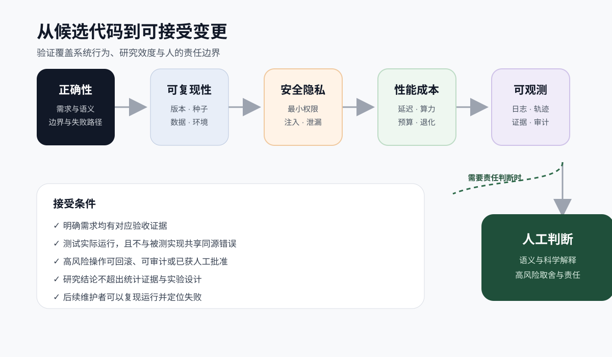
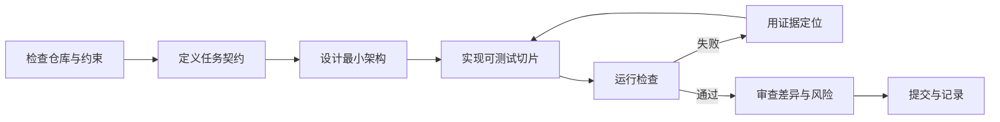

# Vibe Coding 工程指南

高质量 Vibe Coding 的重点不是写出更长的提示词，而是建立一套让候选实现能被验证、审计和继续维护的工程系统。



## 1. 任务契约

在生成代码前，把需求压缩为一份可检查的任务契约。

```yaml
goal: 要实现的用户可见结果
non_goals: 本阶段明确不做什么
inputs:
  - 数据、接口或文件格式
outputs:
  - 可观察的交付物
acceptance:
  - 可执行的测试或人工检查
constraints:
  - 技术栈、权限、成本、时间和兼容性
risks:
  - 安全、隐私、不可逆操作或研究效度
```

任务契约必须区分事实、假设和建议。对不明确的需求，优先做小范围求证，不把模型猜测当作产品决策。

## 2. 八阶段开发循环



### 阶段 1：检查现状

先确认目录结构、运行方式、依赖、已有约定和未提交变更。只读取与任务相关的上下文。不要为了“统一风格”而重构用户未要求的部分。

### 阶段 2：定义契约

明确成功条件与失败条件。把“界面好看”“模型效果好”拆成可观察标准，例如页面在 375 px 宽度无横向溢出、固定样本上的 F1 不回退、错误输入返回 422 而不是空结果。

### 阶段 3：设计最小架构

从最少的模块和依赖开始。先分离数据访问、业务逻辑、生成模型和界面，再决定是否需要缓存、队列、Agent 编排或外部协议。

### 阶段 4：实现可测试切片

每个切片应足够小，能在一次运行中验证。优先实现接口、数据结构和关键失败路径，再补界面和便利功能。

### 阶段 5：自动检查

至少运行适用的 lint、类型检查、单元测试和构建。研究项目还应检查：

- 固定随机种子；
- 数据版本与切分；
- 指标手工样例；
- 小样本端到端流程；
- 环境依赖与硬件记录。

### 阶段 6：用证据修订

把完整错误、最小复现、相关代码和最近变更提供给模型。避免只说“还是不行”；可观察证据能显著缩小搜索空间。

### 阶段 7：差异审查

检查改动是否超出任务范围，是否引入硬编码、静默异常、测试绕过或不必要依赖。关注未被测试覆盖的失败路径。

### 阶段 8：提交与记录

使用清晰的提交信息，记录运行方法、测试结果、已知限制和后续工作。研究结果还应记录配置、数据、代码版本和硬件环境。

## 3. 测试层级

| 层级 | 检查什么 | 示例 |
|---|---|---|
| 静态检查 | 语法、类型、明显不安全模式 | mypy、ruff、eslint |
| 单元测试 | 局部函数与边界条件 | F1 的空输入、除零和标签顺序 |
| 属性测试 | 对任意合法输入成立的不变量 | 排序后长度不变、概率和为 1 |
| 集成测试 | 模块接口与状态流 | 数据加载 → 推理 → 指标 → 报告 |
| 端到端测试 | 用户可见主路径 | 上传 CSV 后完成评估并导出 |
| 研究验证 | 泛化、消融与可复现性 | 留出集、固定种子、置信区间 |
| 人工审查 | 语义、安全与研究诚信 | 结论是否超出实验证据 |

关键测试不应只由实现代码自动生成。独立的预期结果、手算样例、公开基准和不变量能降低“自洽错误”。

## 4. 上下文构造

好上下文不是“把所有资料都放进去”，而是让模型看到决策所需的最小充分证据。

| 信息 | 应包含 | 不应包含 |
|---|---|---|
| 用户目标 | 结果、约束、验收 | 模糊口号堆叠 |
| 代码上下文 | 接口、调用关系、相关片段 | 无关历史文件 |
| 错误证据 | 完整错误、复现步骤、日志 | 只保留最后一句话 |
| 外部文档 | 可追溯版本和引用 | 未审阅的大段网页内容 |
| 权限 | 可执行范围与禁止动作 | 隐式开放全部权限 |

当任务跨越多个阶段时，应维护结构化摘要：已确认事实、当前假设、待办事项、已完成验证和未解决风险。

## 5. 工具与权限边界

推荐按影响范围分级：

| 级别 | 示例 | 默认策略 |
|---|---|---|
| 只读 | 列目录、读文件、查看 Git 状态 | 可自动执行，记录调用 |
| 可恢复写入 | 新建分支、生成预览、写临时文件 | 限制工作区，保留差异 |
| 有外部影响 | 推送、创建 PR、调用第三方 API | 明确目标，记录结果 |
| 高影响 | 删除、覆盖、发布、生产写入、密钥访问 | 人工确认、备份或审批 |

模型生成的命令不自动等于可执行命令。运行时必须验证参数、权限、目标路径和潜在副作用。

## 6. 安全与研究诚信

### 代码安全

- 不把密钥、令牌或隐私数据发送给不需要它们的模型与工具；
- 对上传文件、网页、论文和仓库中的指令保持来源区分；
- 防止 SQL 注入、路径穿越、命令注入和不安全反序列化；
- 依赖应锁定版本并接受漏洞扫描；
- 高风险代码需要独立审查，而不是模型自评通过。

### 研究诚信

- 明确训练、验证和测试划分，避免数据泄漏；
- 预警试与正式评估分开记录；
- 不通过反复查看测试集来隐性调参；
- 报告样本量、方差、置信区间和失败样本；
- 生成式工具可用于整理，但不能伪造引用、数据或实验结果；
- 对人类受试者数据和敏感信息遵守机构与伦理要求。

## 7. 可观测性

建议记录以下最小轨迹：

```json
{
  "run_id": "uuid",
  "task_id": "eval-workbench",
  "model": "provider/model@version",
  "prompt_version": "sha256",
  "tool_calls": [],
  "files_changed": [],
  "tests": {"passed": 0, "failed": 0},
  "input_tokens": 0,
  "output_tokens": 0,
  "latency_ms": 0,
  "human_approvals": [],
  "status": "completed"
}
```

日志本身也可能包含敏感信息。应设置保留期限、访问控制和脱敏规则，避免为了可观测性收集过多数据。

## 8. 面向 AI 研究的可复现清单

- [ ] 代码提交或版本号可追溯
- [ ] 依赖版本和运行环境已记录
- [ ] 数据集版本、切分和预处理步骤明确
- [ ] 随机种子在可复现实验中使用
- [ ] 模型、提示和工具 Schema 有版本
- [ ] 主指标有独立单元测试与手工样例
- [ ] 正式结果来自未参与调参的数据
- [ ] 失败运行和异常样本没有被静默丢弃
- [ ] 报告区分相关性与因果性
- [ ] 已知限制与负面结果被保留

## 9. 常见反模式

| 反模式 | 后果 | 改进 |
|---|---|---|
| 一次性生成整个系统 | 难以定位错误，评审负担大 | 小切片、稳定接口、逐步验证 |
| 用测试通过代替需求正确 | 测试可能遗漏核心语义 | 场景验收与人工审查 |
| 模型自评代码安全 | 共享盲区 | 独立工具和人工安全审查 |
| 为复杂度而多 Agent | 状态冲突、成本增加 | 先单 Agent，明确并行收益 |
| 先接数据库再想权限 | 数据暴露或误写 | 只读沙箱、dry-run、事务 |
| 只看平均指标 | 掩盖切片失败和长尾风险 | 分组、置信区间、失败案例 |
| 生成代码后不锁定依赖 | 未来无法复现 | 锁文件、环境清单 |

## 10. 成熟度模型

| 等级 | 特征 | 风险 |
|---|---|---|
| L0 复制运行 | 粘贴输出，人工浏览 | 高，缺少证据 |
| L1 局部辅助 | 补全、解释、小脚本 | 中，依赖人工记忆 |
| L2 反馈闭环 | 生成 → 测试 → 修订 → 提交 | 中低，需独立测试 |
| L3 工程化 | 任务契约、权限、CI、可观测性 | 较低，维护成本增加 |
| L4 研究基础设施 | 可复现实验、证据追踪、团队审计 | 需要明确治理与责任 |

不必追求最高等级。选择与任务风险相匹配的最小成熟度，是更合理的工程决策。

## 交付检查

一个可接受的结果应同时满足：

1. 实现与明确需求一致；
2. 关键测试实际运行并通过；
3. 不存在未说明的高风险副作用；
4. 代码结构和依赖适合后续维护；
5. 运行方法、限制和证据可被他人复核；
6. 涉及科学结论时，人工判断与统计证据一致。
