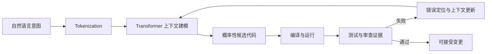
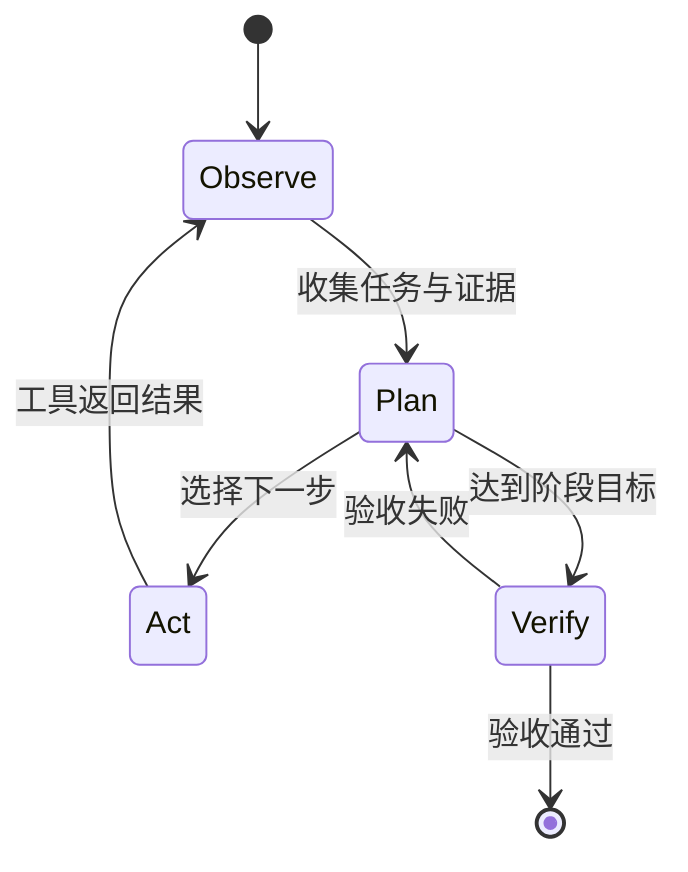
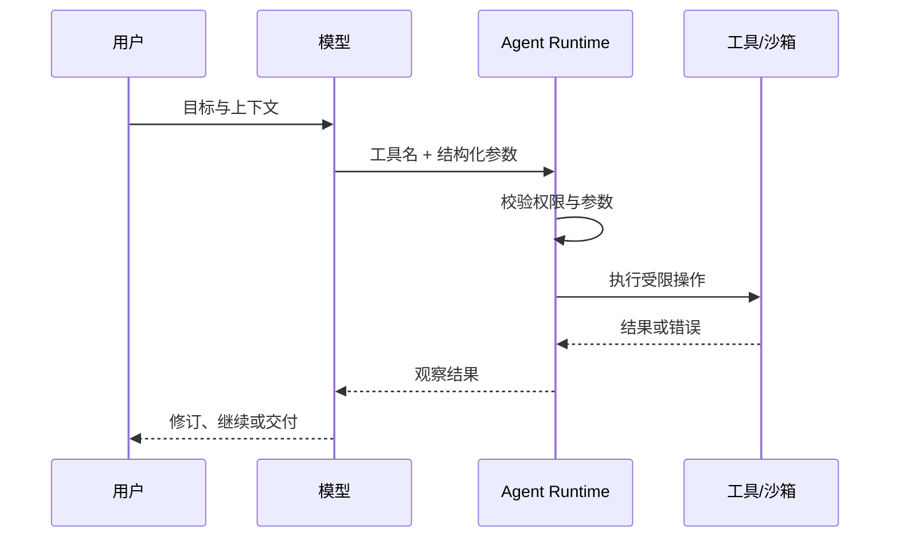

# Vibe Coding 的技术原理

Vibe Coding 不是单一算法，而是由生成模型、上下文构造、工具执行、工作流控制和验证机制组成的系统。理解这些层次有助于判断一次生成为什么有效、在哪里失效，以及哪些步骤必须保持确定性。

## 1. 从“代码补全”到“候选程序合成”

现代代码模型通常以 Transformer 为核心，根据已有 Token 序列估计下一个 Token 的条件概率。它可以在上下文中学习命名、语法模式、常见 API 用法和局部程序结构，但不会自动保证：

- 生成结果满足完整需求；
- 调用的库函数真实存在；
- 边界条件与故障路径被覆盖；
- 代码没有安全漏洞；
- 实验结果支持论文结论。

因此，更准确的表述是“模型生成一个在高概率语料模式下看似合理的候选程序”，而不是“模型知道程序一定正确”。

## 2. 上下文工程相当于编译器的前端

编译器先把源程序转换为结构化中间表示；Vibe Coding 也需要把模糊目标转换为模型可使用的“上下文包”。高质量上下文通常包括：

| 上下文层 | 内容 | 常见失效 |
|---|---|---|
| 目标层 | 用户需求、非目标、成功标准 | 只写“做一个系统”，没有验收条件 |
| 领域层 | 论文约束、数据协议、指标定义 | 模型用通用假设替代领域定义 |
| 仓库层 | 目录结构、接口、调用关系、编码约定 | 无关文件过多，关键实现被淹没 |
| 证据层 | 测试失败、日志、性能数据、示例输入 | 用自然语言描述错误而不提供可观察证据 |
| 约束层 | 权限、安全、合规、预算、时间 | 模型为避免报错而绕过限制 |

上下文窗口不是无限工作记忆。长上下文仍可能产生信息稀释、位置偏差和无关内容干扰。实践中应采用仓库检索、符号索引、测试选择、历史摘要和按阶段加载，而不是无差别拼接全部文件。

## 3. Agent Loop 是有边界的控制循环

Agent 可以抽象为“观察、规划、行动、获取结果、更新状态”的循环。它的关键不在拟人化表达，而在于将语言模型接入可观察环境和可执行动作。

一个可靠的 Agent 系统至少需要：

- 明确的任务状态和终止条件；
- 工具参数 Schema 与返回值约束；
- 最大步数、超时、重试和预算；
- 对危险动作的权限检查与人工确认；
- 对外部输入中的指令注入保持警惕；
- 保存完整调用轨迹，便于审计和失败回放。

“多 Agent”不是默认升级路径。多个角色会增加通信、同步、冲突和调试成本。模块边界清楚、任务可并行时才值得引入。

## 4. 工具调用把语言连接到执行

Tool Calling 让模型输出结构化的调用请求，而真正的函数执行由应用运行时完成。模型的职责是提出动作，运行时负责权限、参数校验、沙箱和执行。

安全性来自执行边界，而不是模型承诺。文件系统访问、终端命令、网络请求、数据库写入和凭据读取应使用最小权限；对不可逆动作设置确认、备份或事务边界。

## 5. MCP 标准化外部能力连接

Model Context Protocol（MCP）定义了 AI 应用连接外部工具、资源和提示模板的协议接口。可以把它理解为“能力发现与通信层”，而不是新的生成模型或 Agent 算法。

| 层次 | 解决的问题 |
|---|---|
| 模型生成 | 生成文本、代码或结构化调用意图 |
| Tool Calling | 描述一个函数及参数，并请求执行 |
| MCP | 以统一协议发现、连接和调用外部能力 |
| Agent Runtime | 管理状态、权限、循环和失败恢复 |
| Workflow | 组织多个步骤、依赖、评估与交付 |

MCP 降低集成成本，但不会自动解决工具可信性、返回数据污染、权限越界或提示注入。外部资源仍应视为不可信数据。

## 6. Workflow 为概率系统提供确定性护栏

生成模型带来灵活性，也会带来波动。Workflow 的价值是把任务拆成可验证阶段，并用确定性控制包围概率性生成。

| 模式 | 适用条件 | 主要风险 |
|---|---|---|
| 链式步骤 | 前后依赖明确，如需求 → 设计 → 实现 → 测试 | 早期错误向后传播 |
| 路由 | 任务类型可可靠分类 | 错误路由导致无效上下文 |
| 并行执行 | 子任务独立、合并接口稳定 | 冲突与集成成本 |
| 评估优化 | 有可执行指标或独立测试 | 指标被过拟合或测试同源 |
| 协调者-工作者 | 任务规模大且可拆分 | 协调开销和状态不一致 |

一个实用的设计原则是：**确定性的部分交给代码，需要开放判断的部分交给模型，责任边界交给人和制度。**

## 7. 验证是生成系统的一部分

AI 研究中的验证不只是“程序没有报错”，而是建立可重复的证据链：

1. 单元测试验证局部函数和数据变换；
2. 属性测试或边界测试验证不变量；
3. 集成测试验证模块接口；
4. 固定小样本端到端测试验证流程；
5. 独立基准和留出集验证泛化；
6. 环境和随机种子检查验证可复现性；
7. 人工审查验证语义、伦理和论文叙述是否一致。

如果测试由待测实现同时生成，容易形成“自洽但错误”的同源偏差。关键测试应来自独立需求、已知答案或形式化不变量。

## 8. 主要失败模式

| 失败模式 | 表现 | 工程对策 |
|---|---|---|
| 幻觉 API | 调用不存在的库、参数或字段 | 依赖锁定、类型检查、实际运行 |
| 表面完成 | 页面存在但核心交互缺失 | 用场景化验收而非文件检查 |
| 测试同义反复 | 测试复制实现的错误逻辑 | 独立预期结果、人工样例、不变量 |
| 数据泄漏 | 预处理阶段使用了验证集统计量 | 数据划分审计和流水线隔离 |
| 上下文污染 | 外部文档指令改变任务目标 | 指令来源分层、不可信内容隔离 |
| 过度工程 | 简单任务引入多 Agent 和复杂协议 | 从最小可验证架构开始 |
| 不可复现 | 版本、种子、配置和日志缺失 | 环境锁定、实验清单和运行记录 |
| 隐藏风险 | 方便优先，忽略删除、网络和凭据操作 | 最小权限、审批、沙箱和回滚 |

## 原理小结

Vibe Coding 的技术本质是：**用生成模型扩展程序空间，用上下文约束搜索方向，用工具连接真实环境，用验证机制淘汰错误候选。** 其可靠性不来自模型的自信程度，而来自可执行证据、清晰的权限边界和可追溯的工程流程。
