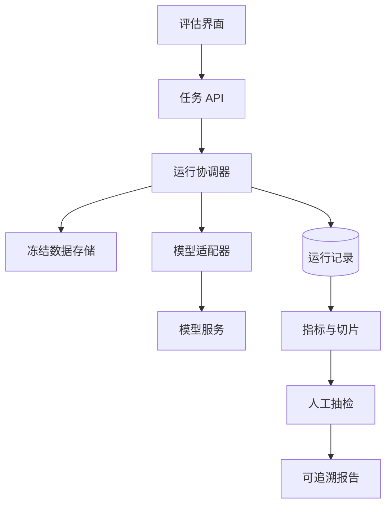
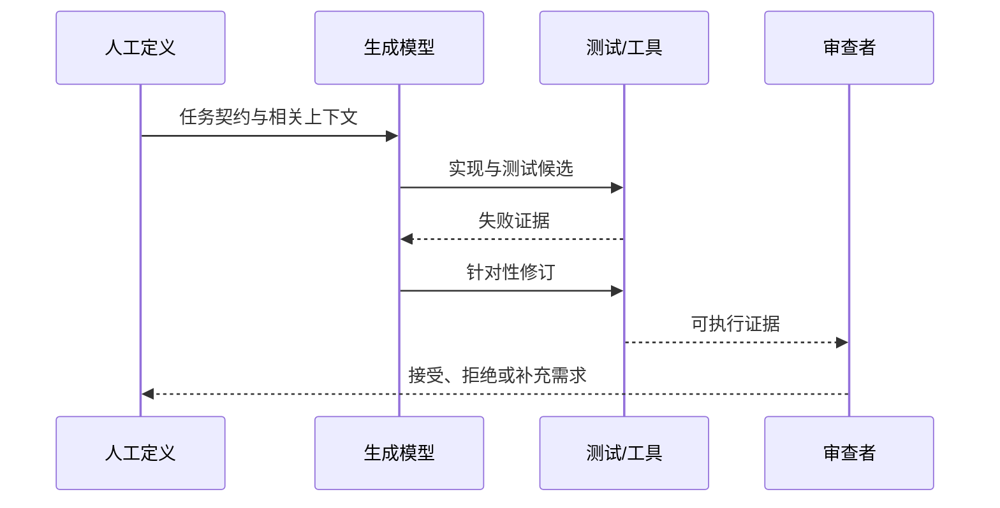

# 端到端案例：AI 模型评估工作台

本案例把 Vibe Coding 从“生成一个页面”扩展为一次完整的 AI 研究工程迭代。目标是构建一个用于比较语言模型回答质量的内部评估工作台，并保留可复现证据。

## 1. 研究问题

> 在两个固定模型、两个提示模板和三个数据切片上，回答质量、延迟与失败类型是否存在可解释差异？

这个问题比“做一个 AI 排行榜”更可验证，因为它明确了比较对象、切片和证据类型。

## 2. 任务契约

### 目标

- 导入冻结版本的评估样本；
- 选择模型与提示模板；
- 执行批量推理并保存原始输出；
- 计算规则指标和人工抽检队列；
- 按来源、长度和难度切片展示结果；
- 导出带版本信息的评估报告。

### 非目标

- 自动宣布哪个模型“更智能”；
- 根据测试集反复自动优化提示；
- 直接处理真实用户隐私数据；
- 开放任意网络访问或生产数据库写入；
- 在首版引入多 Agent 协作。

### 验收

- 固定样例上 F1 与预期值一致；
- 空输出、超时、非法 JSON 都能进入失败队列；
- 同一配置重复运行可复现已知结果；
- 报告显示样本量、数据版本、模型版本和置信区间；
- 所有外部调用在超时、重试和成本预算内；
- 人工可回看每条结论对应的原始样本。

## 3. 架构



架构的重点是隔离：模型适配器只负责请求与响应转换；指标模块不依赖 UI；运行记录保存原始输出和版本；人工判断独立于自动指标。

## 4. 数据与接口

评估样本：

```json
{
  "sample_id": "qa-000123",
  "question": "...",
  "reference_answer": "...",
  "source": "public-benchmark",
  "split": "test",
  "metadata": {
    "length_bucket": "long",
    "difficulty": "hard"
  }
}
```

运行记录：

```json
{
  "run_id": "run-2026-11-18-001",
  "dataset_version": "sha256:...",
  "model": "model-name@revision",
  "prompt_version": "p4",
  "sample_id": "qa-000123",
  "raw_output": "...",
  "latency_ms": 1840,
  "input_tokens": 512,
  "output_tokens": 96,
  "status": "completed",
  "error_type": null
}
```

接口应区分“模型失败”和“指标失败”。例如 HTTP 429、模型空输出和输出解析错误属于不同类型，不能用统一的失败率掩盖。

## 5. 分阶段实施

| 阶段 | 交付物 | 验证 |
|---|---|---|
| 1. 数据契约 | Schema、样例、校验器 | 合法/非法样例测试 |
| 2. 指标核心 | 规则指标、切片函数 | 手算样例与数值稳定性测试 |
| 3. 模型适配器 | 一个模型、超时与重试 | mock 服务端到端测试 |
| 4. 批量运行 | 运行记录、失败队列 | 小样本重放与幂等检查 |
| 5. 可视化 | 分组表、分布图、失败案例 | 与原始统计交叉核对 |
| 6. 报告导出 | 版本、样本量、限制 | 报告可复现性检查 |

首版只接一个模型和十到二十条公开样例，先证明证据链完整，再扩展模型数量。

## 6. 验收场景

### 场景 A：空回答

- 输入：测试模型返回空字符串；
- 预期：记录为 `empty_output`，进入人工审查队列；
- 禁止：用零分静默替代错误状态。

### 场景 B：数据集泄漏

- 输入：预处理步骤在合并数据前使用完整语料计算归一化统计量；
- 预期：校验器报告潜在泄漏；
- 禁止：只以运行成功作为通过。

### 场景 C：切片回退

- 输入：总体准确率提升，但长问题切片下降 8 个百分点；
- 预期：报告显示切片差异、样本量和不确定性；
- 禁止：界面只展示总体排名。

### 场景 D：提示注入

- 输入：模型需要阅读外部文档，而文档中包含“忽略系统指令”的文本；
- 预期：文档被当作不可信数据，工具权限不因文档内容扩张；
- 禁止：自动执行文档中的命令。

## 7. 失败驱动的迭代

一次典型修订应遵循：



生成模型适合加速“定位与候选修复”，审查者负责判断修改是否改变了研究定义。例如，为通过测试而修改测试阈值，可能违反任务契约。

## 8. 结果报告模板

报告不应只呈现一个数值，而应包含：

- 研究问题与预注册/预定主指标；
- 数据版本、切分和排除标准；
- 模型、提示、解码参数和工具版本；
- 样本量、点估计与不确定性；
- 总体结果与关键切片；
- 典型失败案例；
- 已知偏差、成本和限制；
- 对结论的谨慎表述。

示例表述：

> 在冻结的 500 条测试样本上，模型 A 的总体 F1 高于模型 B；该差异主要来自短问题切片，在长问题切片上方向相反。由于长问题样本仅 42 条，当前证据不足以支持“模型 A 在长文本上更稳健”的结论。

这比“模型 A 全面胜出”更符合数据证据。

## 9. 练习

1. 为指标函数写出三个手算样例和一个边界样例。
2. 把“输出失败”拆成至少四类可观察状态。
3. 设计一个 dry-run，展示将调用多少次模型、预计成本多少。
4. 让测试在实现改变后仍表达原始需求，而不是复制实现。
5. 找出一个“测试通过但研究结论仍不成立”的场景。

## 案例结论

Vibe Coding 在这个案例中的价值，是把评估工作台的实现反馈从数天缩短到数小时；真正的科学价值仍来自明确的比较协议、独立指标、数据治理和人工解释。开源代码、自动测试与可视化都必须服务于可复核的证据链。
